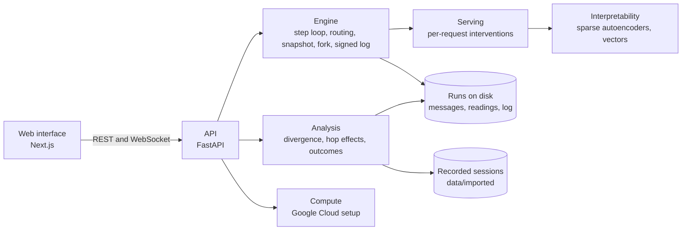

# Architecture

## Overview



## Modules

| Path | Purpose |
|---|---|
| `mosaic/schemas.py` | Typed records and experiment configuration |
| `mosaic/serve/backend.py` | Batched generation with one intervention list per request |
| `mosaic/interp/sae.py` | JumpReLU sparse autoencoder in the Gemma Scope 2 layout |
| `mosaic/engine/topology.py` | Populations and message edges |
| `mosaic/engine/sim.py` | The step loop, routing, snapshot, and restore |
| `mosaic/engine/fork.py` | Paired control and treatment branches from one snapshot |
| `mosaic/engine/log.py` | Hash chain with an ed25519 signature per AI agent |
| `mosaic/engine/checker.py` | Deterministic stand-in for a proof checker |
| `mosaic/analysis/metrics.py` | Divergence front, hop effects, and bootstrap estimates |
| `mosaic/analysis/recorded.py` | Results for recorded sessions, in the shape of a live fork |
| `mosaic/importers/pilot.py` | Import of pilot sessions, with hash chains verified |
| `mosaic/api/` | REST endpoints, WebSocket progress, and the background worker |
| `mosaic/compute/gcp.py` | Key validation and Google Cloud commands |
| `mosaic/cli.py` | The `mosaic` command |
| `web/` | The Next.js interface |
| `configs/` | Experiment YAML files |

## Causal design

Each branch receives identical sampling seeds, derived from the experiment seed, the AI agent, the step, and the replicate. Paired branches differ through the intervention alone. Batch-invariant mode batches prompts of one length, leaving every row unpadded. Log entries exclude wall-clock fields, giving identical chains to branches with identical work.

## Interventions

A forward hook on one decoder block edits only the rows with an intervention. Clamp and ablate edit along one decoder row of the sparse autoencoder, preserving reconstruction error. Add edits along a named vector.

## Files on disk

```
runs/experiments/<experiment>/
  config.yaml
  record.json              git commit and creation time
  contagion.json           measured edges from replays
  snapshots/step_<n>.json
  forks/<fork>/
    spec.json
    fork.json              written on completion
    r000-control/
      messages.jsonl
      outcomes.jsonl
      readings.parquet
      log.jsonl
      branch.json
    r000-treatment/
    r000-control2/         noise floor for replicate 0
```
