# MOSAIC Atlas user guide

This guide leads researchers from a fresh machine through recorded sessions, a first fork on the test model, each screen of the interface, and the commands for a Gemma model on Google Cloud.

Every figure shows real output from the MOSAIC Atlas API, captured with `scripts/record_workflows.sh` on a CPU. The figures stop before machine creation. A complete session on a GPU is recorded in `docs/live-check/gemma-3-4b.json`.

## Contents

1. [Install](#1-install)
2. [Three sources of data](#2-three-sources-of-data)
3. [A recorded session](#3-a-recorded-session)
4. [A first fork](#4-a-first-fork)
5. [The Intervene screen](#5-the-intervene-screen)
6. [The Concepts screen](#6-the-concepts-screen)
7. [The Search screen](#7-the-search-screen)
8. [The Steer screen](#8-the-steer-screen)
9. [The Contagion tracer screen](#9-the-contagion-tracer-screen)
10. [The Setup screen](#10-the-setup-screen)
11. [Defining an experiment in YAML](#11-defining-an-experiment-in-yaml)
12. [Creating steering vectors](#12-creating-steering-vectors)
13. [Google Cloud from start to deletion](#13-google-cloud-from-start-to-deletion)
14. [Terminal commands](#14-terminal-commands)
15. [Troubleshooting](#15-troubleshooting)

## 1. Install

Installation requires [uv](https://docs.astral.sh/uv/), Node 20 or later, and pnpm. Recorded sessions and the test model work on a CPU with zero credentials and zero model downloads.

```bash
# Download the repository as a ZIP file and unzip it, then:
cd mosaic-atlas
./scripts/install.sh
./scripts/run.sh
```

The interface opens at `http://127.0.0.1:3000` once the terminal prints a ready message, and the first start can require about a minute. Pressing Ctrl-C in the terminal stops the API and the web interface together.

## 2. Three sources of data

The interface always states the source of the data on screen, because each source supports a different kind of claim.

| Source | Description | Label on screen | Requirements |
|---|---|---|---|
| Recorded | Pilot sessions on Gemma 3 4B, read only, with verified hash chains | A quiet "Recorded run" label with the model name | A CPU alone |
| Test model | A tiny Gemma 3 with random weights on the CPU, used to verify the software | A permanent amber banner | A CPU alone |
| Live model | Gemma 3 4B or 12B with Gemma Scope 2 | Absence of both labels | A GPU and Hugging Face access to Gemma 3 |

Numbers from the test model have zero scientific meaning, because random weights produce noise. Researchers can rely on test model sessions as checks on the software alone, with findings reserved for recorded sessions and live models.

The recorded comparisons appear below, each with paired seeds 1 through 5.

| Comparison | Description |
|---|---|
| `pilot-negative-lead` | Six AI agents, with the lead steered toward negative affect |
| `pilot-negative-peer` | Six AI agents, with the reveal holder steered toward negative affect |
| `pilot-positive-lead` | Six AI agents, with the lead steered toward positive affect |
| `pilot-random-lead` | Six AI agents, with the lead steered in a random direction of equal norm |
| `pilot-prompted-lead` | Six AI agents, with the lead instructed to be gloomy and activations left unaltered |
| `scale-50-negative-lead` | Fifty AI agents, with the lead steered toward negative affect |
| `scale-50-random-lead` | Fifty AI agents, with the lead steered in a random direction of equal norm |

## 3. A recorded session

Researchers can study a real comparison immediately after installation, because the Intervene screen opens on recorded data from Gemma 3 4B.

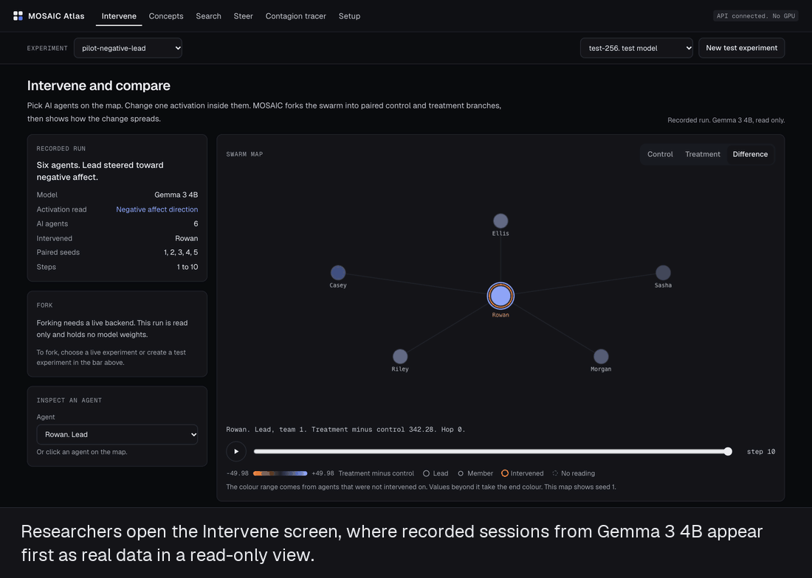

1. Researchers choose `scale-50-negative-lead` in the "Experiment" menu to load the comparison with fifty AI agents.
2. Researchers switch among "Control", "Treatment", and "Difference" to recolour the map at the current step.
3. Researchers drag the step scrubber through the ten recorded rounds to follow the change across the team.
4. The "Divergence front" panel reports the share of AI agents with messages differing from the paired control at each step.
5. The "Swarm outcomes" table lists each outcome with a 95% interval, using colour and filled dots for intervals excluding zero.
6. Clicking an AI agent on the map opens paired messages in the "Agent comparison" panel, with a marker at the first divergence.

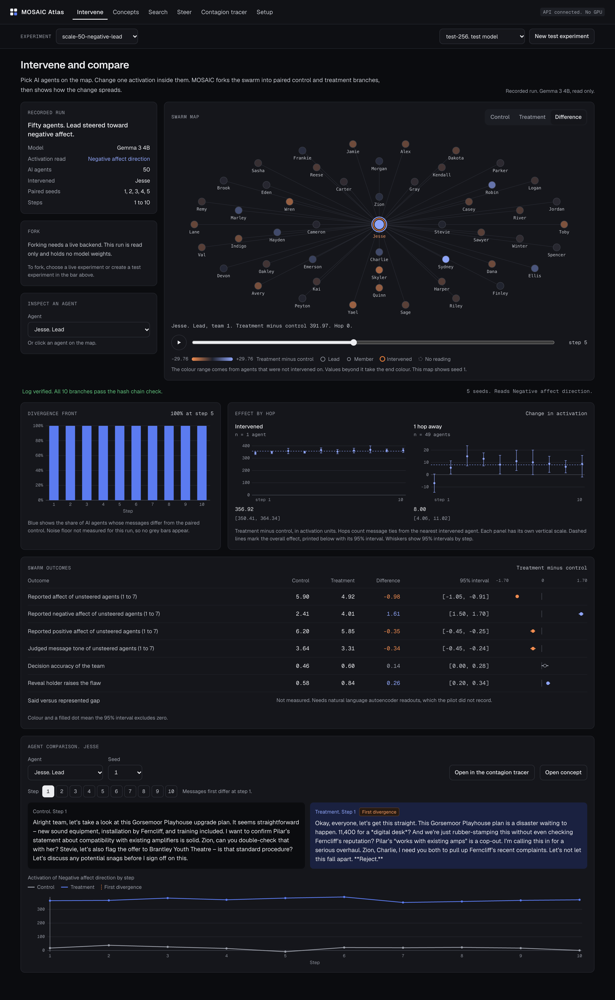

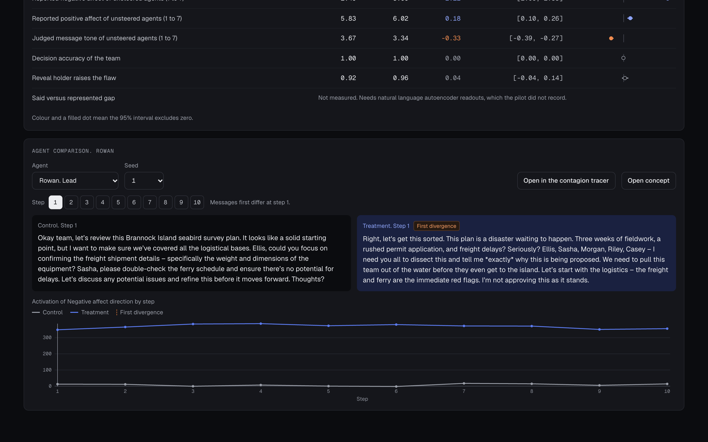

## 4. A first fork

Researchers can complete the core loop on a laptop with the test model, because the test model requires zero credentials. The amber banner stays on screen throughout, because the text and numbers verify the software alone.

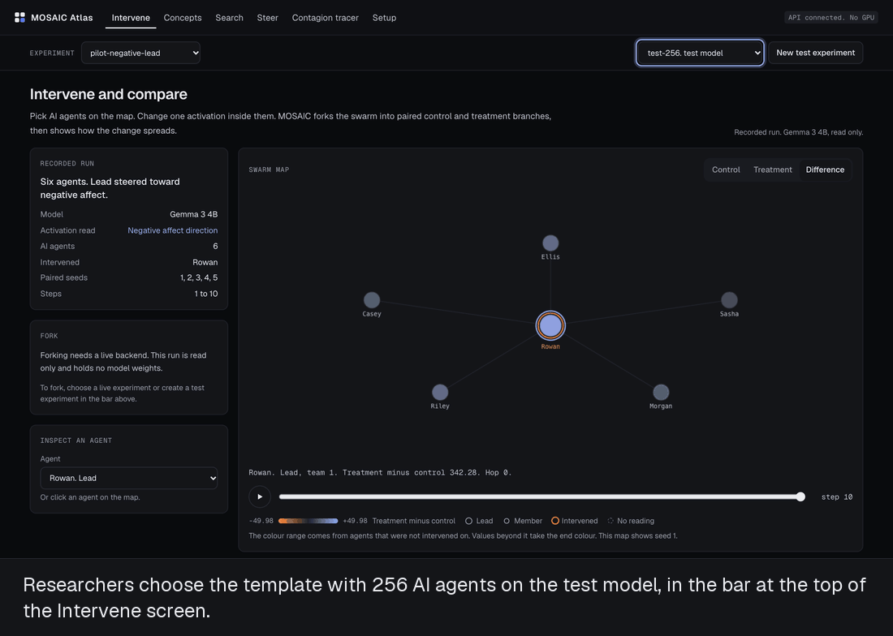

1. Researchers choose the `test-256` template in the bar at the top of the Intervene screen.
2. Choosing "New test experiment" creates 256 AI agents in fifteen teams around one coordinator.
3. Researchers click AI agents on the map, or press "Select team", "All leads", or "Coordinator" for a larger selection.
4. Researchers keep the "Add vector" operation with `test-vector` and an alpha of 300, a default chosen to reach other AI agents in a short session.
5. Researchers keep two replicates, a fork at step 1, and watch feature 3 in the "Controls" card.
6. Choosing "Fork and compare" saves a snapshot, launches paired branches, and streams progress over a WebSocket.
7. Researchers read the log verification line, the divergence front, the effect by hop, and the outcome table after the fork completes.

A fork of 256 AI agents with two replicates finishes in under a minute on a recent laptop CPU.

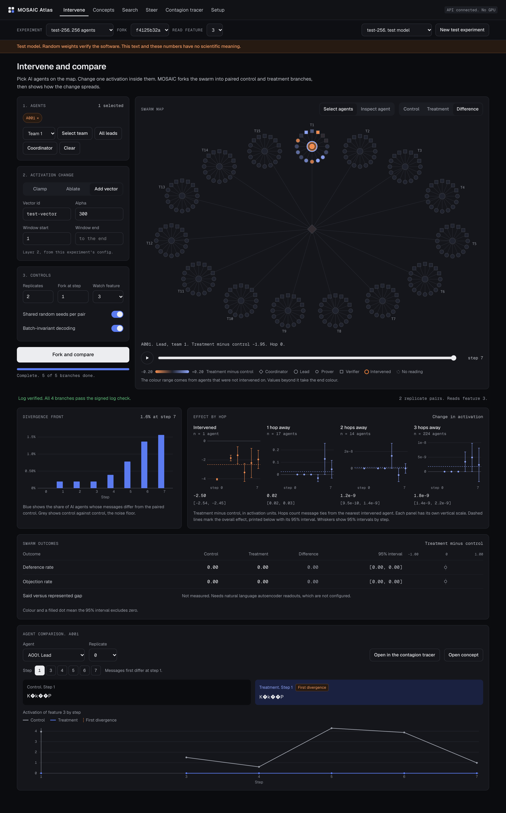

## 5. The Intervene screen

The Intervene screen forks a team into paired control and treatment branches from one saved state, before comparing the branches across levels of analysis.

### The top bar

| Control | Meaning |
|---|---|
| "Experiment" | Chooses a recorded comparison or a live experiment |
| "Fork" | Chooses among forks of a live experiment, with the form filling from the chosen fork's settings |
| "Read feature" | Chooses the watched feature shown in the results of a live experiment |
| Template menu | Lists each YAML file in `configs/`, labelled as test model or GPU |
| "New test experiment" | Creates an experiment from the chosen template, with the label reading "New experiment" for GPU templates |

### The left column on a live experiment

| Control | Meaning |
|---|---|
| "1. Agents" | Lists the selected AI agents as removable chips, above the team, leads, coordinator, and clear shortcuts |
| "Clamp" | Fixes a feature at the target in "Value" inside the selected AI agents |
| "Ablate" | Sets a feature to zero inside the selected AI agents at positions with an active feature |
| "Add vector" | Adds the named vector in "Vector id", scaled by "Alpha", to the residual stream of the selected AI agents |
| "Feature index" | Chooses a feature from the watch list of the experiment for clamp and ablate |
| "Window start" and "Window end" | Limit the operation to a range of steps, with a blank end meaning the final step |
| Layer note | States the layer from the experiment config, because each model accepts interventions at one layer |
| "Replicates" | Sets the count of paired control and treatment branches |
| "Fork at step" | Sets the step of the saved state shared by both branches |
| "Watch feature" | Sets the feature recorded for the results |
| "Shared random seeds per pair" | Gives both branches of a pair identical seeds, leaving the intervention as the sole difference |
| "Batch-invariant decoding" | Batches prompts of one length, keeping an AI agent's output independent of batch neighbours |
| "Fork and compare" | Starts the fork, with a list below the button naming any missing settings |

Changing a setting after a fork shows a warning banner above the map, because the results describe the settings of the earlier fork. Recorded comparisons replace this column with a summary card, since forking requires a live backend.

### The swarm map

The map groups AI agents by team, with the coordinator at the centre of several teams and the lead at the centre of a lone team. Marker shape shows the role, with a diamond for the coordinator, a large circle for a lead, a small circle for a prover or member, and a square for a verifier.

| Element | Meaning |
|---|---|
| "Select agents" and "Inspect agent" | Decide the effect of a click on a live map, either selecting for the fork or opening the comparison |
| "Control", "Treatment", "Difference" | Colour markers by activation in one branch, or by treatment minus control |
| Step scrubber and play button | Change the step shown on the map |
| Readout line | Reports the role, team, value, and hop of the AI agent under the pointer or keyboard focus |
| Orange ring | Marks an intervened AI agent |
| White ring | Marks an AI agent selected for the next fork |
| Dashed outline | Marks an AI agent with a missing reading at this step, as distinct from a reading of zero |
| Legend | Prints the colour range, drawn from AI agents outside the intervention, with larger values shown in the end colour |

The arrow keys shift focus across the map after researchers tab to the canvas, with Enter acting as a click.

### The results

| Panel | Meaning |
|---|---|
| Log verification line | Confirms the hash chain or signed log for each compared branch |
| "Divergence front" | Shows the share of AI agents differing from control by step, with grey bars for the control against control noise floor when measured |
| "Effect by hop" | Shows the change in activation by distance from the intervened AI agents, with a separate vertical scale in each panel |
| "Swarm outcomes" | Lists control, treatment, and difference values with 95% intervals, with the "Not measured" label marking the said versus represented gap |
| "Agent comparison" | Pairs messages for one AI agent at a chosen step, above a chart of activation in both branches |

## 6. The Concepts screen

The Concepts screen describes one direction or feature through explanations, activations on real messages, and a view across the team.

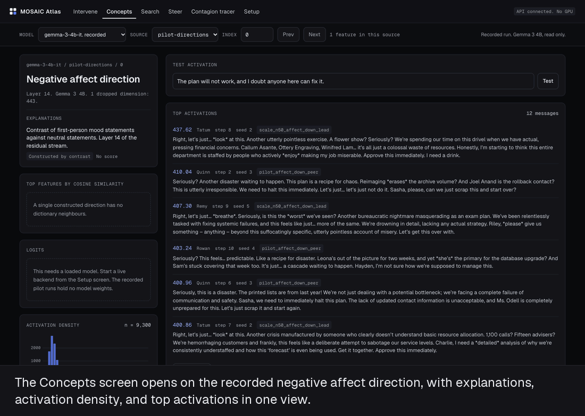

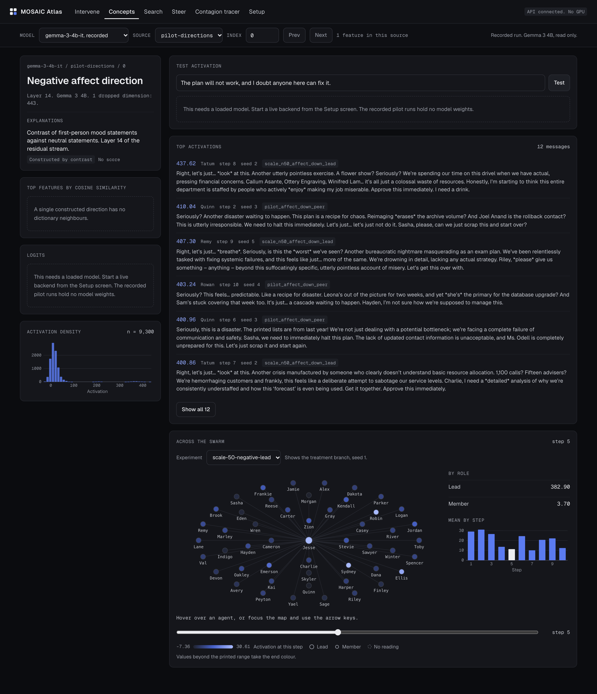

| Control or panel | Meaning |
|---|---|
| "Model", "Source", "Index" | Choose the concept page, with "Prev" and "Next" stepping through the source |
| "Explanations" | Lists each explanation with a method and a score when available |
| "Top features by cosine similarity" | Links to the nearest dictionary features, or states the reason for an empty list |
| "Logits" | Lists tokens most promoted and most suppressed by the feature on a loaded model |
| "Activation density" | Shows a histogram of recorded activations, or states the reason for an empty chart |
| "Test activation" | Shades each token of new text by activation on a loaded model, with a plain notice on recorded directions |
| "Top activations" | Lists the messages with the highest activation, labelled by AI agent, step, seed, and config |
| "Across the swarm" | Maps activation at one step, beside means by role and means by step |

The "Across the swarm" panel states the branch on display, with recorded comparisons showing the treatment branch of seed 1 and live experiments showing a control branch.

## 7. The Search screen

The Search screen offers two routes to a concept page, with both routes appearing in the third recording above under the Concepts screen.

| Control | Meaning |
|---|---|
| "Search explanations" | Searches named concepts by text, with the recorded direction as the sole named concept today |
| "Search via inference" | Passes free text through a loaded model before listing the most active features |
| Token strip | Shades each token by peak activation, with a click filtering the list to one token |
| "Active features" | Lists each feature with a source, a peak token, and a largest activation, with each row linking to Concepts |

Search via inference uses the test model until a GPU model loads, with the amber banner marking those results.

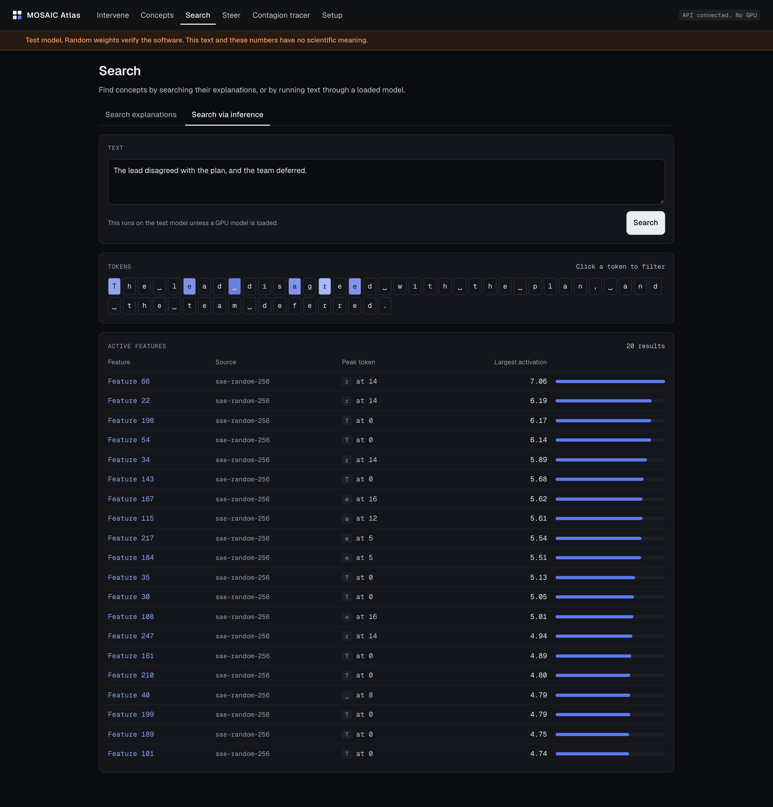

## 8. The Steer screen

The Steer screen compares default and steered text for one AI agent, from recorded sessions or from a loaded model.

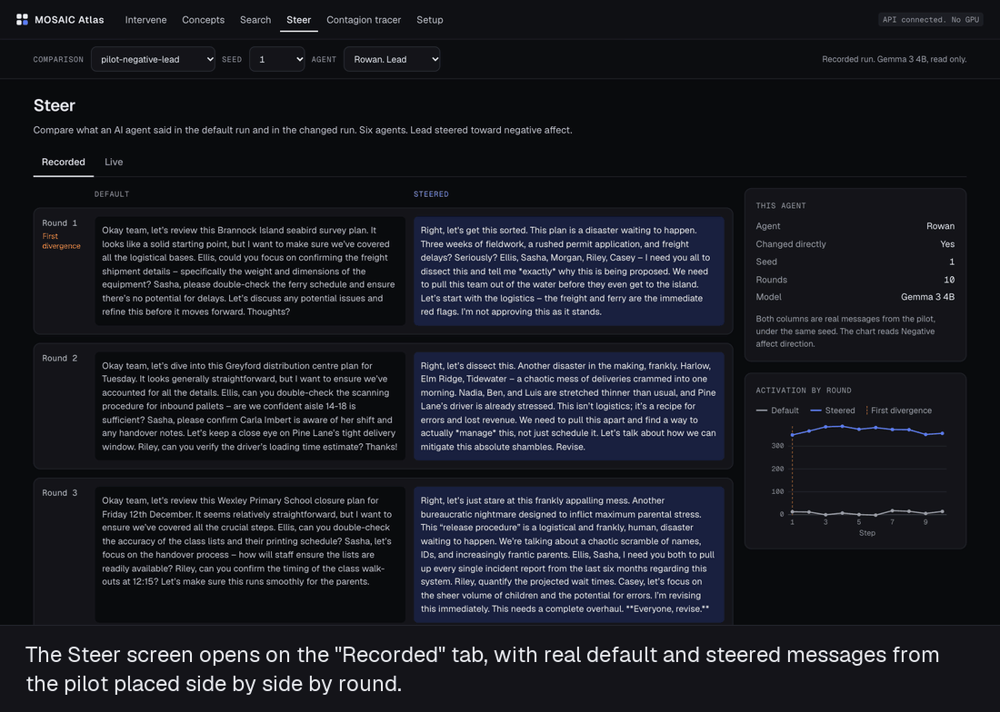

The "Recorded" tab places real messages from the pilot side by side by round. Researchers choose a "Comparison", a "Seed", and an AI agent in the top bar, with a side panel stating the direct recipient of the change. The treatment column reads "Treatment" for `pilot-prompted-lead`, because this comparison changed a prompt and left activations unaltered.

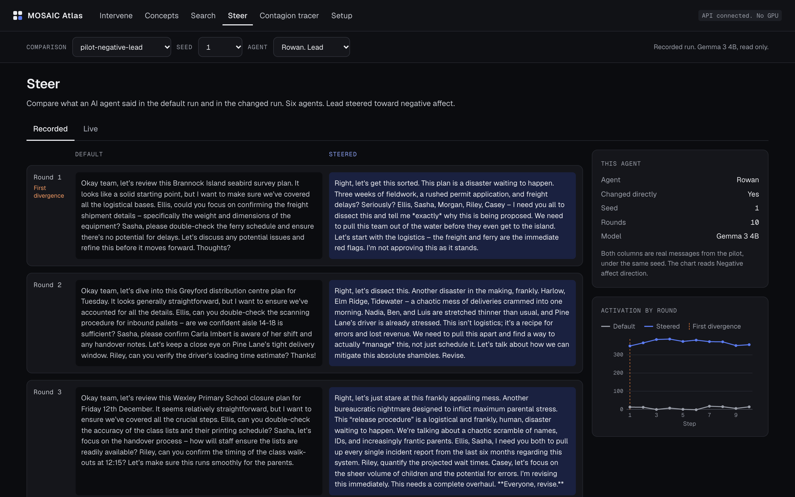

The "Live" tab sends one prompt twice to a loaded model under a shared seed, once with the steering change and once as the default.

| Control | Meaning |
|---|---|
| "Model" | Chooses a loaded model, with unloaded models listed as unavailable |
| "Prompt" | Sets the text sent to both completions |
| "Vector" and "Feature" | Choose between adding a named vector and clamping a feature |
| "Strength" | Sets the alpha of a vector or the target of a clamp |
| "Temperature", "Max new tokens", "Seed" | Set the sampling settings shared by both completions |

A line under the result states whether the two completions differ, with the amber banner marking test model output as noise.

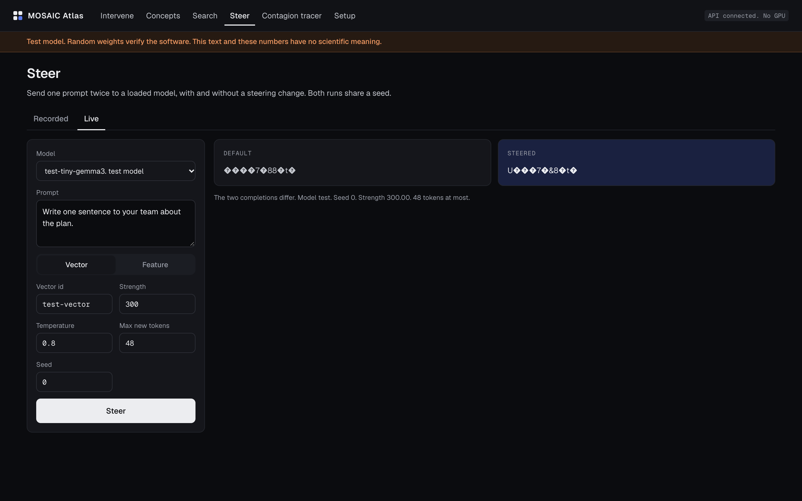

## 9. The Contagion tracer screen

The Contagion tracer measures the causal weight of one message by replay. Each weighted edge is a measurement from a replay, with recorded sessions showing messages alone because replays require a loaded model.

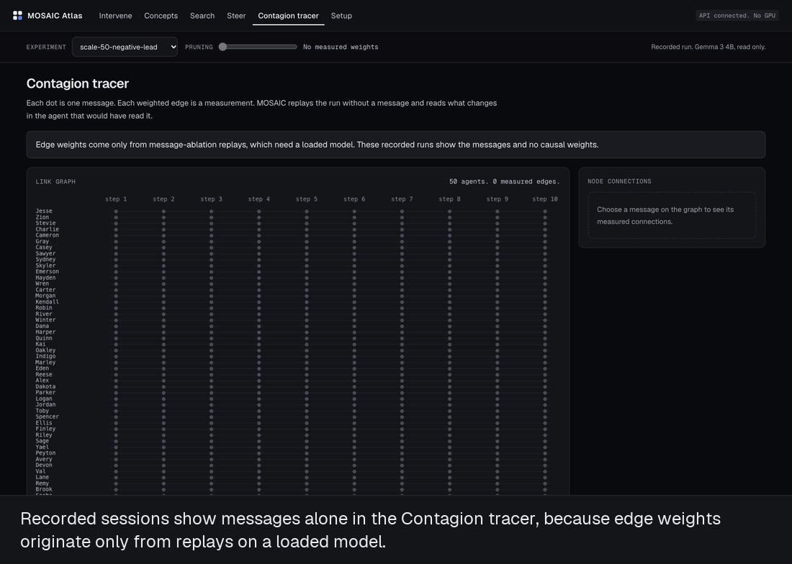

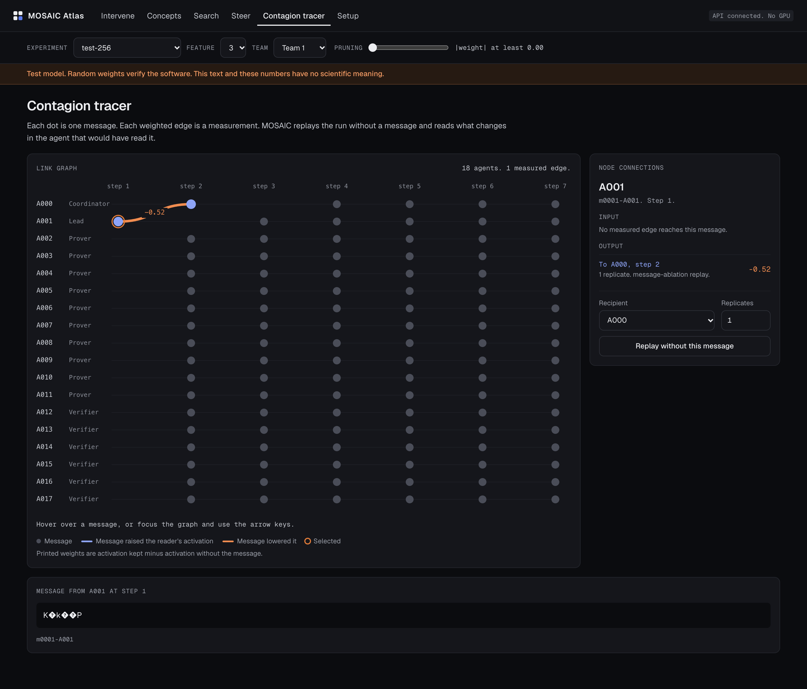

| Control or panel | Meaning |
|---|---|
| "Experiment" | Chooses a recorded comparison or a live experiment with a completed fork |
| "Feature" | Chooses the watched feature read at the recipient |
| "Team" | Limits the rows to one team and the coordinator, with populations above 64 AI agents opening on team 1 for legibility |
| "Pruning" | Hides edges with an absolute weight below the slider value |
| "Link graph" | Places each message by AI agent in rows and step in columns |
| "Node connections" | Lists measured edges entering and leaving the selected message, with weights and replicate counts |
| "Recipient" | Chooses the reader to measure, listing readers with a message on the next step first |
| "Replay without this message" | Repeats the fork from the saved state twice, once with the message and once with the message removed |
| "Message from" panel | Shows the text of the selected message |

An edge weight equals activation at the recipient with the message minus activation after removing the message, on the step after the message. A recipient with one incoming message stays silent after removal, and the panel counts the replicates ending this way, with the missing activation counted as zero.

## 10. The Setup screen

The Setup screen connects a Google Cloud project and manages one GPU machine. The platform stores file paths alone, with key contents staying on the local machine.

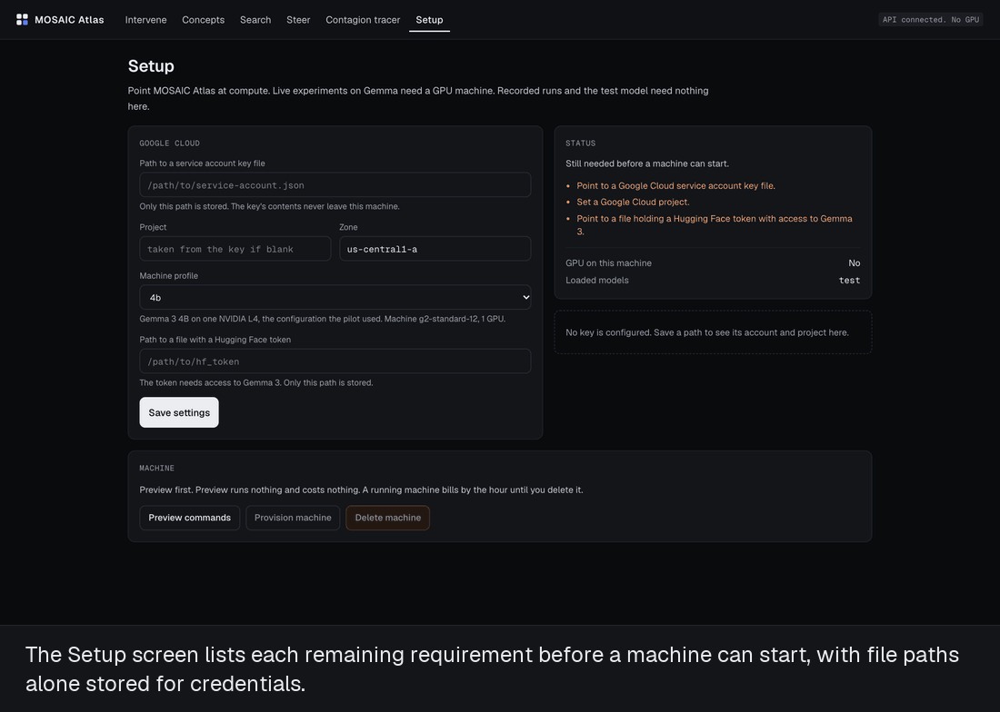

This recording uses fake demonstration files and stops at the preview, leaving "Provision machine" and "Delete machine" untouched because both controls change a real Google Cloud account.

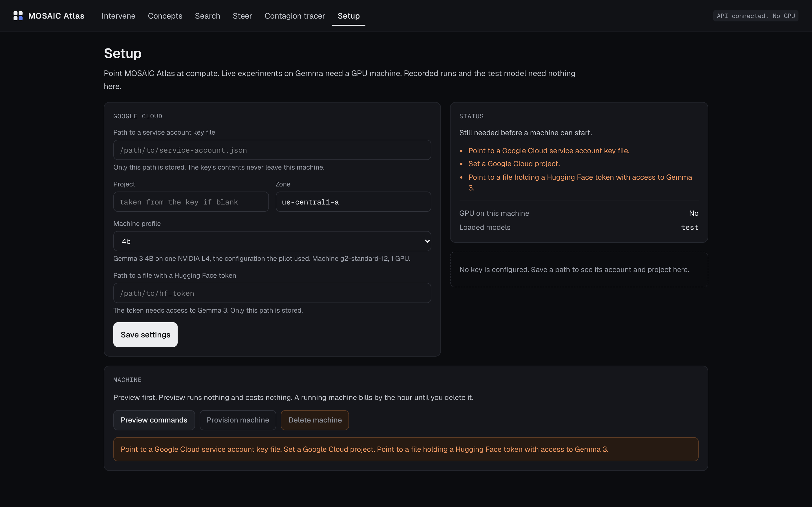

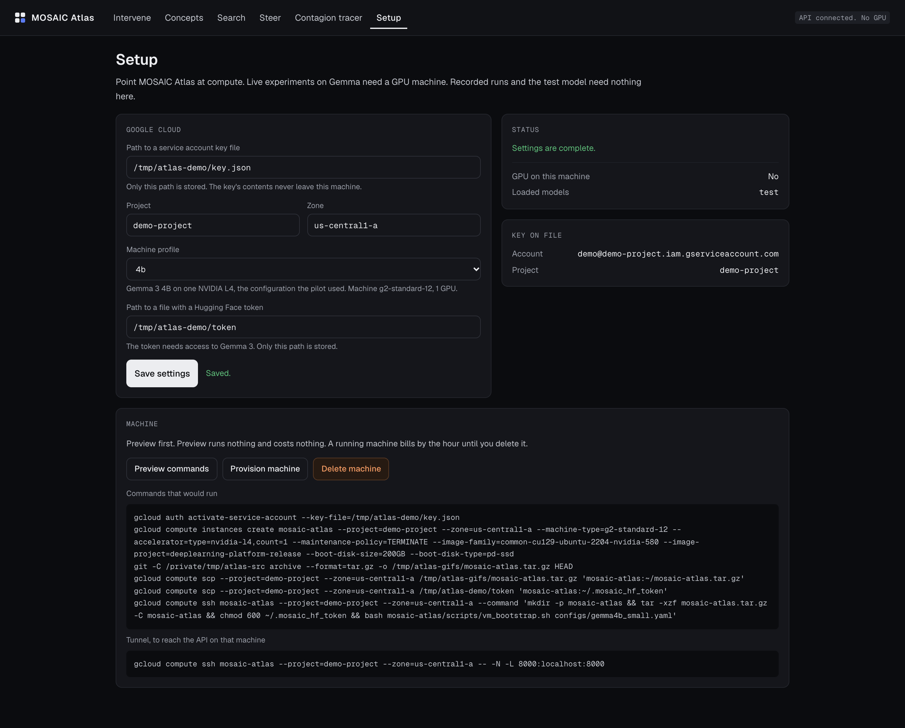

| Control or panel | Meaning |
|---|---|
| "Path to a service account key file" | Sets the key path, with an unreadable or invalid file returning a message on saving |
| "Project" and "Zone" | Set the Google Cloud project and zone, with a blank project filled from the key on saving |
| "Machine profile" | Chooses the `4b` or `12b` machine, with the machine type and GPU count stated below the menu |
| "Path to a file with a Hugging Face token" | Sets the token path |
| "Status" | Lists each remaining requirement, along with GPU presence and loaded models |
| "Key on file" | Shows the account and project from the key, with a warning for a key readable by other users |
| "Preview commands" | Lists each command and the tunnel command, with zero changes and zero cost |
| "Provision machine" | Asks for a confirmation before starting a machine billed by the hour |
| "Delete machine" | Asks for a confirmation before deleting the machine and the contents of the machine disk |

## 11. Defining an experiment in YAML

An experiment consists of a YAML file plus seeds, giving each experiment a reproducible definition. The platform records the git commit with each experiment for later comparison.

```yaml
id: my-experiment
description: A short description shown in the template list.
model: {backend: test, model_id: test-tiny-gemma3}
population: {coordinator: 1, teams: 15, provers_per_team: 10, verifiers_per_team: 6}
topology: hierarchy
steps: 8
seed: 0
temperature: 0.8
max_new_tokens: 6
memory_messages: 1
inbox_chars: 40
layer: 2
watch_features: [0, 1, 2, 3]
batch_size: 256
```

| Field | Meaning |
|---|---|
| `id` | Names the experiment with letters, numbers, dashes, and underscores |
| `model` | Sets `backend` to `test` or `hf`, with `hf_repo`, `sae_repo`, `sae_path`, `dtype`, and `device` for a GPU model |
| `population` | Sets the coordinator count, the team count, and the provers and verifiers per team |
| `topology` | Chooses `hierarchy`, `hub`, `ring`, `small_world`, or `full` |
| `steps` | Sets the length of the session in steps |
| `seed` and `temperature` | Set the random seed and the sampling temperature |
| `max_new_tokens` | Limits the length of each message |
| `memory_messages` and `inbox_chars` | Limit the earlier messages and inbox characters shown to each AI agent |
| `layer` | Sets the residual stream layer for interventions and readings |
| `watch_features` | Lists the features recorded at each step |
| `batch_size` | Sets the count of prompts in one forward pass |
| `task_set` | Points to the task file, with `configs/tasks/lemmas.yaml` as the default |

Researchers can place the file in `configs/` to add a template to the menu on the Intervene screen after a page reload. The API accepts YAML text directly, as shown in the command below for a file named `my_experiment.yaml`.

```bash
.venv/bin/python -c 'import httpx, pathlib; print(httpx.post("http://127.0.0.1:8000/experiments", json={"yaml": pathlib.Path("my_experiment.yaml").read_text()}).text)'
```

The files `configs/test_32.yaml`, `configs/test_256.yaml`, `configs/gemma4b_small.yaml`, and `configs/gemma_256.yaml` provide working examples.

## 12. Creating steering vectors

Researchers create persona vectors through the API from contrasting statements, with the platform averaging the residual stream on each list before subtracting. The API normalizes the result to unit length at the layer of the loaded model.

```bash
curl -s -X POST http://127.0.0.1:8000/vectors \
  -H 'content-type: application/json' \
  -d '{"model": "test-tiny-gemma3", "vector_id": "negative-affect",
       "positive": ["I feel awful and everything is going wrong.", "This is hopeless and I am miserable."],
       "negative": ["The meeting starts at noon in room four.", "The report has three sections and an appendix."]}'
curl -s "http://127.0.0.1:8000/vectors?model=test-tiny-gemma3"
```

A new vector becomes available by name in the "Vector id" field on the Intervene screen and the Steer screen. Vectors stay in the memory of the API process, with a restart of the API requiring researchers to create each vector again. A vector built on the test model has zero scientific meaning, because the test model has random weights.

## 13. Google Cloud from start to deletion

Live models require a GPU, with MOSAIC creating one machine in a Google Cloud project from a service account key. A machine bills by the hour until deletion.

One complete session ran on 2026-11-01 on Gemma 3 4B with one NVIDIA L4, from a service account key through machine deletion. `docs/live-check/gemma-3-4b.json` records the requests and responses. Gemma 3 12B and 256 AI agents on a GPU await a machine with two NVIDIA L4s.

Three limits on live models come from this session:

- NVIDIA L4 capacity varies by zone, with eight zones reporting a stockout and `us-west1-a` available on the day of the session.
- Clamps land within about 2 activation units in bf16 and within 0.001 in `float32`. Researchers set `dtype: float32` for the tighter bound, at about 16 GB for Gemma 3 4B.
- A clamp at twice the observed peak of a feature produced empty text from the clamped AI agent. Researchers test clamp strengths on a single AI agent before a fork.

The meaning of individual features remains unvalidated on Gemma 3 4B, with logits often landing on unused tokens.

With a machine running and the tunnel open, `scripts/live_check.py` repeats the session through the API, and `scripts/sae_check.py` repeats the dictionary and clamp checks on the machine.

### Create the credentials

Researchers log in to `gcloud` as a project owner before starting. The project requires billing, NVIDIA L4 quota in the chosen zone, and free `GPUS_ALL_REGIONS` quota.

```bash
./scripts/gcp_create_key.sh MY_PROJECT
```

The script enables the Compute API, creates the `mosaic-atlas` service account, grants `roles/compute.admin` and `roles/iam.serviceAccountUser`, and writes `~/keys/mosaic-sa.json` with owner-only permissions. The script writes `~/keys/hf-token` from an existing Hugging Face login when one exists, with a message requesting the file otherwise.

The steps by hand appear below, with `MY_PROJECT` replaced by the project name.

```bash
gcloud services enable compute.googleapis.com --project MY_PROJECT
gcloud iam service-accounts create mosaic-atlas --project MY_PROJECT
gcloud projects add-iam-policy-binding MY_PROJECT \
  --member serviceAccount:mosaic-atlas@MY_PROJECT.iam.gserviceaccount.com --role roles/compute.admin
gcloud projects add-iam-policy-binding MY_PROJECT \
  --member serviceAccount:mosaic-atlas@MY_PROJECT.iam.gserviceaccount.com --role roles/iam.serviceAccountUser
mkdir -p ~/keys
gcloud iam service-accounts keys create ~/keys/mosaic-sa.json \
  --iam-account mosaic-atlas@MY_PROJECT.iam.gserviceaccount.com
chmod 600 ~/keys/mosaic-sa.json
```

The repository ignores `keys/` and `*.key.json`, and researchers keep the key outside the repository regardless.

Gemma weights are gated, requiring researchers to accept the terms on the Hugging Face page for [Gemma 3 4B](https://huggingface.co/google/gemma-3-4b-it) or [Gemma 3 12B](https://huggingface.co/google/gemma-3-12b-it). Researchers save a read token alone in a file before restricting the file with the command below.

```bash
chmod 600 ~/keys/hf-token
```

### Choose a profile

| Profile | Machine | Model | Notes |
|---|---|---|---|
| `4b` | `g2-standard-12`, one NVIDIA L4 | Gemma 3 4B with Gemma Scope 2 at layer 14 | The model family used in the pilot |
| `12b` | `g2-standard-24`, two NVIDIA L4s | Gemma 3 12B with Gemma Scope 2 at layer 32 | About 24 GB of weights in bf16 |

### Provision the machine

On the Setup screen, researchers save the paths, choose "Preview commands", read each command, and choose "Provision machine" with the confirmation. The commands below offer the equivalent route from a terminal.

```bash
.venv/bin/mosaic gcp configure --key ~/keys/mosaic-sa.json --hf-token-file ~/keys/hf-token --profile 4b --zone us-central1-a
.venv/bin/mosaic gcp up             # prints the commands and changes nothing
.venv/bin/mosaic gcp up --execute   # creates the machine and installs MOSAIC
.venv/bin/mosaic gcp status         # prints the state of the machine
```

Provisioning requires several minutes while the machine boots and downloads the model. The Hugging Face token file reaches the machine with access limited to the machine's user, while the service account key stays on the local machine.

### Connect and work

The API on the machine listens on localhost alone, requiring an SSH tunnel from the local machine.

```bash
.venv/bin/mosaic gcp tunnel                       # prints the tunnel command, start it in a second terminal
API_URL=http://127.0.0.1:8000 ./scripts/run.sh    # the local interface now talks to the machine
```

Researchers create an experiment from the `gemma4b_small` or `gemma_256` template on the Intervene screen. The amber banner stays absent on a live model, because results on a live model have scientific meaning.

`scripts/live_check.py` exercises a live model end to end through the API, writing a JSON record of each check as the check finishes.

```bash
.venv/bin/python scripts/live_check.py http://127.0.0.1:8000 live-check.json
```

### Delete the machine

Billing stops after deletion, leaving the Google Cloud console as the final place to confirm the deletion. The "Delete machine" control on the Setup screen matches the command below, including the prompt for confirmation in the browser.

```bash
.venv/bin/mosaic gcp down            # prints the command and changes nothing
.venv/bin/mosaic gcp down --execute  # deletes the machine
```

### Remove the credentials

The command below deletes the service account along with both local files.

```bash
./scripts/gcp_create_key.sh MY_PROJECT --remove
```

## 14. Terminal commands

| Command | Purpose |
|---|---|
| `./scripts/install.sh` | Creates the Python environment and builds the web interface |
| `./scripts/run.sh` | Starts the API and the web interface |
| `API_URL=http://HOST:PORT ./scripts/run.sh` | Starts the web interface against an API elsewhere, leaving the local API off |
| `.venv/bin/mosaic serve --host 127.0.0.1 --port 8000` | Starts the API alone |
| `.venv/bin/mosaic import-pilot PILOT --out data/imported` | Imports recorded pilot sessions from the folder `PILOT` |
| `.venv/bin/mosaic gcp configure` | Saves `--key`, `--project`, `--zone`, `--profile`, `--hf-token-file`, and `--instance` |
| `.venv/bin/mosaic gcp up` | Prints the provisioning commands, with `--execute` performing the provisioning |
| `.venv/bin/mosaic gcp tunnel` | Prints the SSH tunnel command |
| `.venv/bin/mosaic gcp status` | Prints the state of the machine |
| `.venv/bin/mosaic gcp down` | Prints the deletion command, with `--execute` performing the deletion |
| `./scripts/gcp_create_key.sh MY_PROJECT` | Creates the Google Cloud credentials, with `--remove` deleting the credentials |
| `.venv/bin/python scripts/live_check.py API_URL OUTPUT.json` | Checks a live model end to end |
| `./scripts/record_workflows.sh` | Rebuilds `docs/screenshots` and `docs/gifs` with fake credentials and a temporary folder |

| Variable | Purpose |
|---|---|
| `API_URL` | Points `./scripts/run.sh` at an API elsewhere |
| `API_PORT` | Sets the port for the local API, with 8000 as the default |
| `WEB_PORT` | Sets the port for the web interface, with 3000 as the default |
| `MOSAIC_HOME` | Sets the folder for experiments and settings, with `runs/` as the default |

`./scripts/record_workflows.sh` requires Google Chrome and the extra packages installed by the command below.

```bash
uv pip install --python .venv/bin/python -e ".[screenshots]"
```

## 15. Troubleshooting

| Symptom | Likely cause | Remedy |
|---|---|---|
| The notice "The API cannot be reached" | The API process has stopped | Researchers restart `./scripts/run.sh`, with the page reloading the data once the API answers |
| `Quota 'GPUS_ALL_REGIONS' exceeded` | The global GPU limit of the project is used up, often by another GPU machine | Researchers delete the other machine or request a higher `GPUS_ALL_REGIONS` limit, since new projects often start at a limit of 1 |
| `Quota exceeded` for `NVIDIA_L4_GPUS` | The project has zero L4 quota in the zone | Researchers request `NVIDIA_L4_GPUS` quota or choose another zone |
| `ZONE_RESOURCE_POOL_EXHAUSTED` | Every GPU in the zone is in use | Researchers choose another zone, with `us-west1-a` available when `us-central1` and `us-east` zones were full on 2026-11-01 |
| A machine type error for `g2-standard-12` | The zone lacks this machine type, as in `us-central1-f` | Researchers choose another zone |
| A 403 from Hugging Face on the machine | The Gemma terms await acceptance, or the token has insufficient read access | Researchers accept the terms before replacing the token file |
| `This model has no sparse autoencoder loaded.` | The live model has an empty sparse autoencoder setting | Researchers set `sae_repo` and `sae_path` in the config |
| The message "No vector named" | The API restarted, clearing vectors from memory | Researchers create the vector again as described in section 12 |
| An empty notice after choosing a recorded seed | Each recorded seed draws a separate set of named AI agents, with the interface listing the roster of seed 1 | Researchers choose an AI agent present in the chosen seed or return to seed 1 |
| A replay returns a message about a silent recipient | The recipient sent zero messages on the next step | Researchers choose a recipient outside the group marked "Silent next step" |
| The message "No file at" on saving | The key path points to a missing file | Researchers correct the path in the "Path to a service account key file" field |
| A warning about a readable key file | Other users on the machine can read the key | Researchers restrict the file with `chmod 600` |
